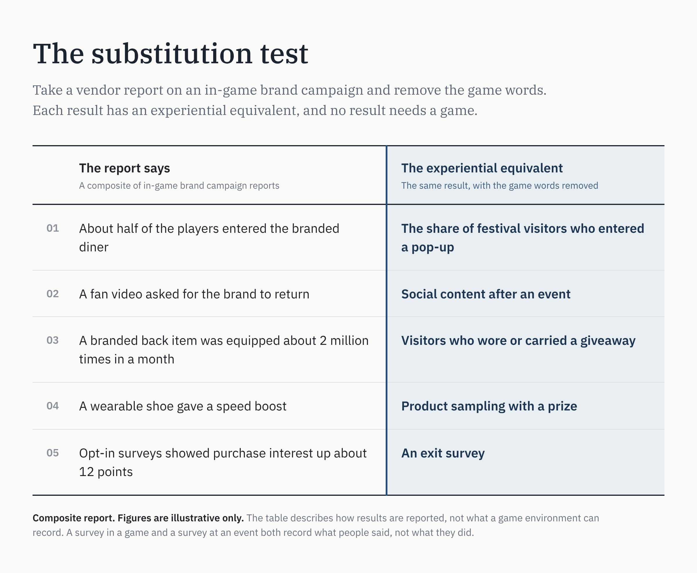

# Participation Is Not the Difference

Digital games are routinely described as experiences. The word is more accurate than the trade admits. When an endemic vendor reports on an in-game campaign, the report has the shape of an experiential report: a space was built, people came in, people talked about it afterwards, and a survey said they liked the brand more.

This matters to a planner because the in-game work is sold as media, not experiential. That pitch makes two claims on working media. The first is that participation is a different kind of result. The second is that the work also delivers impressions. Both claims fail. A third claim stands, and is mostly missed.

### The substitution test

Take a typical vendor report and remove gaming-related words — player, game mechanics, etc. The report below is a composite, and its figures are illustrative only.

Each line has an equivalent, and no line needs a game. The survey line is the clearest example. A survey in a game and a survey at an event both record what people said, not what they did.

### Participation does not differentiate

The usual argument is that people in a game choose to take part, and that an ad cannot give that result. The argument is correct about ads. But experiential gives the same result, and it has done so for decades. A claim on working media needs a different kind of result, not the same result in a new venue.

The branded shoe example shows a second problem. It gave the player a speed boost. A reward attached to the brand's presence is an offer. The players who equipped the shoe possibly wanted the boost. The report cannot differentiate.

### Volume is efficiency inside the shape

Two million equips is more than a physical event can deliver. That is a cost claim. It says the venue gives more participation for each dollar than an event does. Efficiency is useful, but it moves money between lines of the same kind. It does not create a new line.

The claim is also less clean than it looks. An equip is an action, and one player can repeat it many times at no cost. The count gives no population: **it does not say how many people could equip the item and did not.**

### The impression has no object

The impression is the one claim in the report that experiential cannot make. Impression guidelines for games do exist. The IAB, the IAB Tech Lab and the Media Rating Council (MRC) published the Intrinsic In-Game Advertising Measurement Guidelines 2.0 in 2022 [1]. They define a viewable impression for an ad that an ad server places in a game: half of the creative's pixels in view, for one continuous second, on at least 1.5% of the screen. The guidelines work because the object is uniform. Each ad has a creative, a size on the screen, and a time in view.

The guidelines also state their own limit. They do not apply to branded elements that are built into the design of a game, and they do not cover interaction or engagement. Where a logo is on part of an object, the buyer names the area to measure.

A brand presence that is a role moves further from the uniform object. Consider three cases:

- **A wearable on the player's own avatar.** Who is the viewer: the wearer, or each player who passes?
- **A place the player stands inside.** When does the impression start, and when does it end?
- **An ability the player uses.** What is "in view" when the brand is an action?

A later update could set thresholds for these cases, and some platforms already apply criteria of this type to branded assets. But the measured area would be different for each build, and the count would record the opportunity to see a surface. The brand did not buy that. Certification needs one instance that is the same for every advertiser, and a role has one instance for each build. The result is a count that the seller defines for each build.

So the object cannot be uniform. The specification can, however.

### The specification is uniform

The currency route is closed, and participation is shared with experiential. One property is left. The channel definition states it:

*Immersive media is a media channel. Its job is to place brand presence that people can engage with or refuse. The buy returns a record of what the population it reached chose.*

The work in the (hypothetical) composite report is not bought in this way. The line that follows is the claim for the buy that is:

*Immersive media right, bought right, produces a record which shows whether it moved the people it reached, before the sale.*

*Most brand media comes with proof of play. Immersive media comes with proof of response: brand-attributed demand, observed where the brand is, that indicates pre-conversion funnel stages.*

Brand-attributed demand is the observed movement of a population toward a brand's presence, chosen over an alternative and repeated, with no offer attached. The observed behaviors indicate pre-conversion funnel stages.

"Right" means a designed buy, and the design starts with an evidence specification. The specification asks the same of every role a brand takes, whether the role is a diner, a wearable, or an ability:

- An unbranded twin does the same job, with matched traffic.
- The population, the alternative, and the response window are named.
- No reward is attached.
- All four pre-conversion stages are reported.

The form is the same for every buy. The values are set for each buy: which population, which alternative, which window. Not every role passes. A role that cannot produce all four stages is excluded.

The specification is set before the bid, and the vendor commits to it at bid time. So it comes before construction, in time to shape the build. In the composite report, the measurement came after the build, and it could only describe what was already there.

This is what makes the line plannable. Bids that answer the same specification are comparable, and comparison is the job that a currency does on other lines. Two more conditions apply before brand spend can buy the line: vendors must be able to bind to the terms, and the brand must be able to read the record.

A uniform specification is not certification. No outside body accredits the result. The party that the RFP names verifies the record.

Redesign the diner to see the specification work on the build. Put the branded diner and an unbranded twin in the same game, in the same role. Put a rival option beside each, so that a choice is possible. Remove the reward. The population is every account that reached the street, including the accounts that walked past. An illustrative reading: at first encounter, 18% of that population used the branded diner and 11% used the twin, over a four-week window.

That first reading indicates what equity the brand carried in. It does not show what the buy did. The second reading does that: whether the choice grew over the window, beyond the trajectory of the twin. The record can also show that it did not grow.

This is the question the record answers: *Did this buy move the behavior of the people it reached toward the brand, before the sale?*

*Of the lines brand spend can buy, the designed immersive buy is the one whose own response record answers, in behavior, whether the buy moved the people it reached toward the brand, before the sale. Other brand lines answer that question with a survey or a model added afterwards, or they do not answer it.*

### The concession, and the cost of observation

A physical event could run part of this design. Build two pop-ups, one branded and one not, and count the people at each door. That gives the first reading without the identity of any visitor.

The later readings are the problem. To see repeat use, or movement over a window, the event must recognize the same person again. That needs a wristband, an app, or a camera. Each one adds cost, needs consent, and becomes intrusive. A game has the account as a condition of operation, and the record the brand receives is aggregated population behavior, collected within privacy rules.

So the difference is cost and completeness, not possibility. The claim is about defaults, not limits. Any environment that meets the same conditions can produce inventory bought by the line e.g., immersive media is not unique to game environments.

There is also a limit on the record. It shows that people responded, compared with an unbranded equivalent. It does not show that the buy had a sales effect. That much requires calibration using the brand's commercial data.

### The finding

In-game brand work, as it is reported today, is experiential work. Plan it on those terms: outside the media plan, in a capped budget, judged as experiential is judged.

The designed buy is different, and the difference is not participation. It is the specification before the buy and the record after it. When a buy is specified in this way and returns that record, it earns an immersive line in the plan.

### References

1. IAB, IAB Tech Lab and MRC, *Intrinsic In-Game Advertising Measurement Guidelines 2.0*, August 2022: https://www.iab.com/wp-content/uploads/2022/08/In-Game-Advertising-Measurment-Guidelines_08.31.2022.pdf
