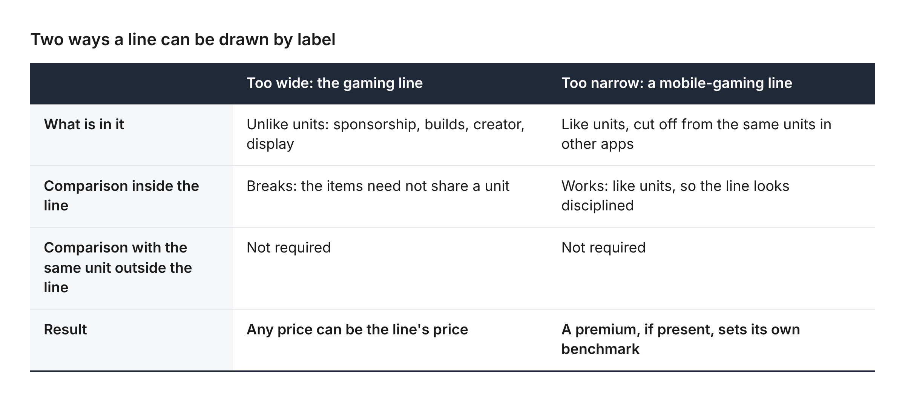
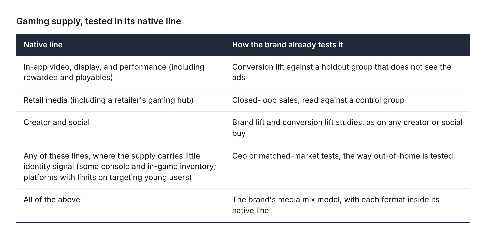

# The Gaming Line Is a Blank Check, Part 2: Every Unit Already Has a Line

*The fix for the gaming line is the planning discipline brands already use for every other dollar.*

## Where Part 1 left off

Part 1 argued that a gaming line is a blank check. Anything with the gaming label can enter it. The line checks what enters on outcomes, against gaming's own bar, as the IAB's *The Business Case for Gaming* (August 2026) lays out. It does not compare the price with the same unit bought elsewhere. CPM gets reported as delivery, but nothing sets it against the same unit lacking the gaming label.

Cost discipline compares every unit with the same unit elsewhere, and a gaming line does not require that comparison. The way to restore it is to return each format to its native line: the line where the brand buys that unit from every other seller. This part sets out the rule that does that, and how a brand tests the result.

To be fair, the IAB does not ask for a gaming line in those words. It says gaming is not one media channel. But its decision path still ends in one gaming recommendation and one next-dollar threshold for gaming. **That is a line in all but name.**

## The other end of the label

A narrower line does not fix the problem. Some sellers frame mobile gaming as a channel of its own. A Kantar study prepared for Axon by AppLovin is titled [*Mobile Gaming: The New Mainstream Consumer Channel*](https://www.businesswire.com/news/home/20260310466304/en) (2026), and the IAB's business case draws on it. A line built on that frame would hold banner, interstitial, rewarded video, native, and playables, bought in game apps. These units do match each other. And the IAB's own format reference files them under display, video, and audio, measured the way those lines are measured.

Cut them off from their peers and the comparison breaks in the same place as in the wide line: no unit has to be set against the same unit in other apps. The narrow line only makes the break harder to see. Inside it, banner can be compared with banner and rewarded video with rewarded video, so the line looks disciplined. But nothing in the line sets any unit against the same unit outside it. **If the line carries a gaming premium, the premium sets its own benchmark.**

A seller can answer that its units perform better: more attention, or more completed views when the player opts in for a reward. That may be true. The native line is where it would show. A unit that beats its peers earns a higher price against them. Only a premium that cannot survive the comparison needs a line of its own.

The cause is the same at both ends. Membership follows where an item runs or what it is called, not what the unit is.

## The rule

The fix is to make membership follow the unit. Stated as a rule, it has two parts:

> Each format goes in the line where the brand buys the same unit from every other seller. A new line earns its place only when being in it predicts the unit, the terms, and the return.

The second part keeps the rule from being a ban on lines defined by environment. CTV passes it. Whether a plan books CTV as its own line or inside video, being CTV predicts the unit and the terms: a TV-screen unit, household reach, and upfront or guaranteed buying. And every CTV unit can be compared with the same unit from every other CTV seller.

Mobile gaming is different. It changes the context of some units, most of all rewarded video and playables, where the player opts in for a reward inside the game. It does not change how the units are bought or measured. Rewarded ads are still display, video, or audio, measured on completion, engagement, and conversion. A higher completion rate is a reason to pay more inside the video line. It is not a reason for a new line. So a line defined by gaming, at any width, fails the test.

A brand could keep a gaming line and benchmark each item against its native line. Then the native line does the pricing, and the gaming line is only a tag on spend. The rule makes that plain.

The industry's own case for gaming leans on CTV too. The IAB puts gaming's reach at 87% of CTV's and its ad spend at 24% of CTV's ([*The Business Case for Gaming*](https://www.iab.com/guidelines/the-business-case-for-gaming/), August 2026). That compares reach and spend. It does not test what defines a line. CTV's own history points to the rule: its money moved when its units could be compared across sellers, on standards shared with video. A gap in spend says where to look. A comparable unit is what lets money move.

## Outcomes: you don't have to take anyone's word for it

Once gaming supply is sorted into its native lines, a brand can buy it and test its effect on the brand's own outcomes. It uses the same methods it uses for every other format. For these formats, no new framework is needed.

Some brands already buy gaming supply this way. In June 2026, AppLovin opened its ad platform, which runs on mobile games, to any business. Online shops can buy it on a return-on-ad-spend target: the brand sets the return it needs, and the platform bids to meet it ([AppLovin](https://www.applovin.com/en/blog/applovin-ads-now-open), 22 June 2026).

The buy is priced on an outcome the brand sets, not on the gaming label. Platform-reported return still links exposure to purchases. It does not show that the ads caused them. A holdout test on the same data closes that gap, and a brand does not need to wait for a gaming framework to run one.

## No conspiracy required

None of this needs bad intent. Any seller can add the gaming label, and a gaming line has no rule that stops it.

Best Buy shows how. Gamers can now buy most games directly from Sony, Nintendo, or Microsoft. Best Buy's new hub is an answer to that. On 20 October 2026, Best Buy launched Best Buy Gamers in beta: a hub on its site and app with IGN content, gamer profiles, preorders, deals, sweepstakes, and store events. Best Buy Ads sells onsite placements in it, along with creator content, social amplification, and sweepstakes. It launched with three sponsors, and Instacart was the first from outside gaming (["Best Buy is betting on retail media’s gaming blind spot"](https://www.thedrum.com/opinion/best-buy-is-betting-on-retail-media-s-gaming-blind-spot), The Drum, 10 November 2026).

By unit, that is retail media, creator, social, and promotions, with gamer interest as a new targeting option. The hub is built for gamers, so the name is accurate. The label also carries a sales case that the industry makes on record. The IAB's PlayFronts recap calls games "high-attention environments" ([IAB](https://www.iab.com/blog/2026-iab-playfronts-event-recap/), 25 September 2026).

Endemic vendors describe the next few years as helping brands shift budgets into them ([iion](https://iion.io/blog/why-smart-brands-are-taking-gaming-seriously-in-conversation-with-andrew-woodhead), 27 April 2026). The high-attention case is accurate for gameplay. Under the gaming label, however, it can attach to non-playable surfaces — like a retailer's web page. Most importantly, nothing requires the unit to be compared with the same unit minus the label. Whether Best Buy prices the hub above its other placements is not known. **The point is that a gaming line would not check.**

It needs no coordination. Every seller that adds the label adds to the bundle. That is why the answer is the rule, not an argument about motives. The rule sorts each format by its unit, so it works the same whoever is selling, and it does not need anyone to have done anything wrong.

## Gaming spend, yes. A gaming line, no.

Brands should spend on gaming wherever a format earns its place. The industry is right about that. What a brand should not do is open a line that any item with the gaming label can enter, and that requires no comparison with anything outside it.

The alternative asks for no new practice. Every format sold as gaming gets a line where it is compared with the same unit elsewhere, and a test of the brand's own outcomes. For most formats, that is a native line. One format earns a line of its own under the second part of the rule: a brand's role inside play. Part 3 takes it up. Everything else is spent the way every other dollar in the plan is spent. Gaming does not need an exception. It needs the same rule.

## Sources

- IAB, [*The Business Case for Gaming*](https://www.iab.com/guidelines/the-business-case-for-gaming/), August 2026
- Kantar for Axon by AppLovin, [*Mobile Gaming: The New Mainstream Consumer Channel*](https://www.businesswire.com/news/home/20260310466304/en), report dated February 2026, released 10 March 2026
- Michael Arzt, IAB, ["2026 IAB PlayFronts Event Recap"](https://www.iab.com/blog/2026-iab-playfronts-event-recap/), 25 September 2026
- iion, ["Why smart brands are taking gaming seriously – in conversation with Andrew Woodhead"](https://iion.io/blog/why-smart-brands-are-taking-gaming-seriously-in-conversation-with-andrew-woodhead), 27 April 2026
- Common Thread Collective, ["AppLovin Ads Is Now Open to All Advertisers: What Ecommerce Brands Need to Know"](https://commonthreadco.com/blogs/coachs-corner/applovin-ads-now-open-all-advertisers-ecommerce-2026), 2 July 2026
- Kiri Masters, ["Best Buy is betting on retail media's gaming blind spot"](https://www.thedrum.com/opinion/best-buy-is-betting-on-retail-media-s-gaming-blind-spot), The Drum, 10 November 2026
